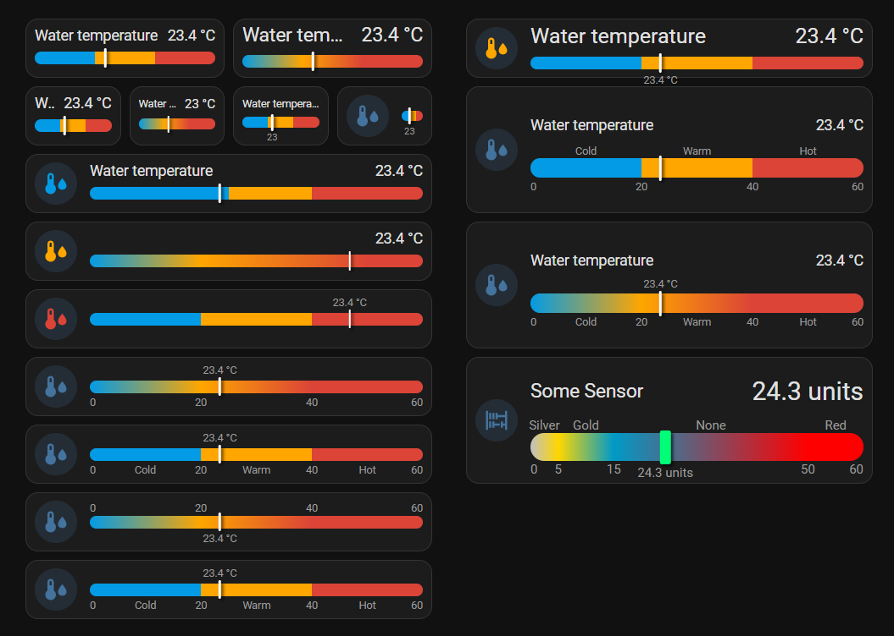
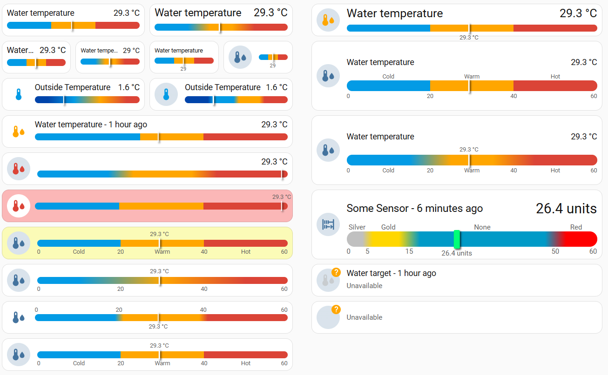

# Horizontal Gauge Card

A highly customizable horizontal gauge card with a needle indicator for Home Assistant.
Inspired by Home Assistant Tile card.




## Features
- With minimalistic settings occupies only 1 row 
- Fully visual editor support (no YAML required!)
- Custom segments with color coding
- Needle indicator with customizable width, color, and shadow
- Toggleable segment names and value labels
- Extensive appearance overrides (font sizes, gauge thickness, custom units)

## Installation
### Marketplace
1. In your Home Assistant instance navigate to Settings -> Marketplace
2. Search for Horizontal Gauge Card
3. Click 'Install' button
4. After installation reload your browser session (CTRL+SHIFT+R) or reload your HA companion app.

### HACS (Recommended)
1. Open HACS in your Home Assistant instance.
2. Click the 3 dots in the top right corner and select **Custom repositories**.
3. Add your repository URL (`https://github.com/iljanev/ha-horizontal-gauge-card`).
4. Select **Dashboard** as the category and click **Add**.
5. Close the modal, search for "Horizontal Gauge Card", and click **Download**.
6. Refresh your browser cache.

### Manual
1. Download `horizontal-gauge-card.js` from this repository.
2. Copy it into your `<config>/www/` directory.
3. Go to **Settings > Dashboards > 3 dots (top right) > Resources**.
4. Add a new resource with the URL `/local/horizontal-gauge-card.js` and set the Resource Type to `JavaScript Module`.

## Defining Segments

You can define segments directly via the visual editor under the "Segments" expandable section. Because it uses Home Assistant's native object editor, you format your segments as a YAML list.

**Example YAML snippet to paste into the Segments box:**
```yaml
- value: 33
  color: var(--info-color)
  label: Low
- value: 66
  color: var(--warning-color)
  label: Med
- value: 100
  color: var(--error-color)
  label: High
```

* **`value`**: The upper limit of the segment (the segment spans from the previous value up to this value).
* **`color`**: The color of the segment (can be HEX like `#FF0000` or a CSS variable like `var(--error-color)`).
* **`label`** *(Optional)*: The name of the segment to display if "Show Segment Labels" is enabled.


**Can be wrapped in config-template-card to allow for dynamic segments:**
```yaml
type: custom:config-template-card
entities:
  - sensor.electricity_price_with_tax_in_cents
variables:
  - states['input_number.price_cheap'].state
  - states['input_number.price_normal'].state
  - states['input_number.price_expensive'].state
card:
  type: custom:horizontal-gauge-card
  entity: sensor.electricity_price_with_tax_in_cents
  name: Electricity Price With Tax
  min: -5
  max: 60
  segments:
    - value: ${parseFloat(vars[0]) - 5}
      color: "#07d"
    - value: ${vars[1]}
      color: "#0a0"
    - value: ${vars[2]}
      color: var(--warning-color)
    - value: ${parseFloat(vars[2]) + 5}
      color: var(--error-color)
```


## Usage
Simply add a new card to your dashboard and select **Horizontal Gauge Card** from the visual picker. You can configure all colors, limits, fonts, and labels directly in the UI.

## Example cards used for the screenshot, replace code of a section
```yaml
type: grid
cards:
  - type: custom:horizontal-gauge-card
    entity: sensor.water_temperature
    min: 0
    max: 60
    show_icon: false
    show_name: true
    show_value: true
    show_segment_labels: false
    show_value_labels: false
    needle: true
    needle_width: 2
    needle_color: '#ffffff'
    needle_shadow: true
    show_needle_label: false
    decimals: 1
    display_rows: 1
    needle_label_position: true
    segment_label_position: above
    segments:
      - value: 20
        color: var(--info-color)
        label: Cold
      - value: 40
        color: var(--warning-color)
        label: Warm
      - value: 60
        color: var(--error-color)
        label: Hot
    grid_options:
      columns: 6
      rows: auto
    icon_color_from_segment: true
  - type: custom:horizontal-gauge-card
    entity: sensor.water_temperature
    min: 0
    max: 60
    show_icon: false
    show_name: true
    show_value: true
    show_segment_labels: false
    show_value_labels: false
    needle: true
    needle_width: 2
    needle_color: '#ffffff'
    needle_shadow: true
    show_needle_label: false
    decimals: 1
    display_rows: 1
    needle_label_position: true
    segment_label_position: above
    segments:
      - value: 20
        color: var(--info-color)
        label: Cold
      - value: 40
        color: var(--warning-color)
        label: Warm
      - value: 60
        color: var(--error-color)
        label: Hot
    name_font_size: 18
    value_font_size: 18
    grid_options:
      columns: 6
      rows: auto
    smooth_gradients: true
  - type: custom:horizontal-gauge-card
    entity: sensor.water_temperature
    min: 0
    max: 60
    show_icon: false
    show_name: true
    show_value: true
    show_segment_labels: false
    show_value_labels: false
    needle: true
    needle_width: 2
    needle_color: '#ffffff'
    needle_shadow: true
    show_needle_label: false
    decimals: 1
    display_rows: 1
    needle_label_position: true
    segment_label_position: above
    segments:
      - value: 20
        color: var(--info-color)
        label: Cold
      - value: 40
        color: var(--warning-color)
        label: Warm
      - value: 60
        color: var(--error-color)
        label: Hot
    grid_options:
      columns: 3
      rows: auto
  - type: custom:horizontal-gauge-card
    entity: sensor.water_temperature
    min: 0
    max: 60
    show_icon: false
    show_name: true
    show_value: true
    show_segment_labels: false
    show_value_labels: false
    needle: true
    needle_width: 2
    needle_color: '#ffffff'
    needle_shadow: true
    show_needle_label: false
    decimals: 0
    needle_label_position: below
    segment_label_position: below
    segments:
      - value: 20
        color: var(--info-color)
        label: Cold
      - value: 40
        color: var(--warning-color)
        label: Warm
      - value: 60
        color: var(--error-color)
        label: Hot
    name_font_size: 10
    value_font_size: 12
    label_font_size: 8
    gauge_thickness: 10
    grid_options:
      columns: 3
    smooth_gradients: true
  - type: custom:horizontal-gauge-card
    entity: sensor.water_temperature
    min: 0
    max: 60
    show_icon: false
    show_name: true
    show_value: false
    show_segment_labels: false
    show_value_labels: false
    needle: true
    needle_width: 2
    needle_color: '#ffffff'
    needle_shadow: true
    show_needle_label: true
    decimals: 0
    needle_label_position: below
    segment_label_position: below
    segments:
      - value: 20
        color: var(--info-color)
        label: Cold
      - value: 40
        color: var(--warning-color)
        label: Warm
      - value: 60
        color: var(--error-color)
        label: Hot
    name_font_size: 10
    value_font_size: 12
    label_font_size: 9
    gauge_thickness: 10
    grid_options:
      columns: 3
    unit: " "
  - type: custom:horizontal-gauge-card
    entity: sensor.water_temperature
    min: 0
    max: 60
    show_icon: true
    show_name: false
    show_value: false
    show_segment_labels: false
    show_value_labels: false
    needle: true
    needle_width: 2
    needle_color: '#ffffff'
    needle_shadow: true
    show_needle_label: true
    decimals: 0
    needle_label_position: below
    segment_label_position: below
    segments:
      - value: 20
        color: var(--info-color)
        label: Cold
      - value: 40
        color: var(--warning-color)
        label: Warm
      - value: 60
        color: var(--error-color)
        label: Hot
    name_font_size: 10
    value_font_size: 12
    label_font_size: 9
    gauge_thickness: 10
    grid_options:
      columns: 3
    unit: " "
  - type: custom:horizontal-gauge-card
    name: Outside Temperature
    min: -15
    show_icon: true
    show_name: true
    show_value: true
    label_font_size: 10px
    show_segment_labels: false
    show_value_labels: false
    needle: true
    needle_width: 2
    needle_color: '#ffffff'
    needle_shadow: true
    show_needle_label: false
    decimals: 1
    display_rows: 1
    needle_label_position: above
    segment_label_position: below
    segments:
      - value: 0
        color: '#04a'
        label: Freezing
      - value: 15
        color: var(--info-color)
        label: Cold
      - value: 30
        color: var(--warning-color)
        label: Warm
      - value: 45
        color: var(--error-color)
        label: Hot
    entity: sensor.vito_outdoor_temp
    max: 45
    smooth_gradients: true
    icon_color_from_segment: true
    gradient_blend: 100
    grid_options:
      columns: 6
  - type: custom:horizontal-gauge-card
    name: Outside Temperature
    min: -15
    show_icon: true
    show_name: true
    show_value: true
    label_font_size: 10px
    show_segment_labels: false
    show_value_labels: false
    needle: true
    needle_width: 2
    needle_color: '#ffffff'
    needle_shadow: true
    show_needle_label: false
    decimals: 1
    display_rows: 1
    needle_label_position: above
    segment_label_position: below
    segments:
      - value: 0
        color: '#04a'
        label: Freezing
      - value: 15
        color: var(--info-color)
        label: Cold
      - value: 30
        color: var(--warning-color)
        label: Warm
      - value: 45
        color: var(--error-color)
        label: Hot
    layout_options:
      grid_columns: 2
      grid_rows: 1
    entity: sensor.vito_outdoor_temp
    max: 45
    smooth_gradients: true
    icon_color_from_segment: true
    gradient_blend: 20
  - type: custom:horizontal-gauge-card
    entity: sensor.water_temperature
    min: 0
    max: 60
    show_icon: true
    show_name: true
    show_value: true
    show_segment_labels: false
    show_value_labels: false
    needle: true
    needle_width: 2
    needle_color: '#ffffff'
    needle_shadow: true
    show_needle_label: false
    decimals: 1
    display_rows: 1
    needle_label_position: true
    segment_label_position: above
    segments:
      - value: 25
        color: var(--info-color)
        label: Cold
      - value: 40
        color: var(--warning-color)
        label: Warm
      - value: 60
        color: var(--error-color)
        label: Hot
    icon_color_from_segment: true
    show_last_updated: true
  - type: custom:horizontal-gauge-card
    entity: sensor.water_temperature
    min: 0
    max: 20
    show_icon: true
    show_name: false
    show_value: true
    label_font_size: 10px
    show_segment_labels: false
    show_value_labels: false
    needle: true
    needle_width: 2
    needle_color: '#ffffff'
    needle_shadow: true
    show_needle_label: false
    decimals: 1
    display_rows: 1
    needle_label_position: true
    segment_label_position: above
    segments:
      - value: 10
        color: var(--info-color)
        label: Cold
      - value: 20
        color: var(--warning-color)
        label: Warm
      - value: 30
        color: var(--error-color)
        label: Hot
    smooth_gradients: true
    icon_color_from_segment: true
    gradient_blend: 30
  - type: custom:horizontal-gauge-card
    entity: sensor.water_temperature
    min: 0
    max: 60
    show_icon: true
    show_name: false
    show_value: false
    show_segment_labels: false
    show_value_labels: false
    needle: true
    needle_width: 2
    needle_color: '#ffffff'
    needle_shadow: true
    show_needle_label: true
    decimals: 1
    display_rows: 1
    needle_label_position: above
    segment_label_position: above
    segments:
      - value: 10
        color: var(--info-color)
        label: Cold
      - value: 20
        color: var(--warning-color)
        label: Warm
        back_color: '#222200'
      - value: 30
        color: var(--error-color)
        label: Hot
        back_color: '#440000'
    value_label_position: above
    icon_color_from_segment: true
  - type: custom:horizontal-gauge-card
    entity: sensor.water_temperature
    min: 0
    max: 60
    show_icon: true
    show_name: false
    show_value: false
    show_segment_labels: true
    show_value_labels: true
    needle: true
    needle_width: 2
    needle_color: '#ffffff'
    needle_shadow: true
    show_needle_label: true
    decimals: 1
    display_rows: 1
    needle_label_position: above
    segment_label_position: below
    segments:
      - value: 20
        color: var(--info-color)
        label: Cold
      - value: 40
        color: var(--warning-color)
        label: Warm
        back_color: '#443600'
      - value: 60
        color: var(--error-color)
        label: Hot
        back_color: '#440000'
    value_label_position: below
  - type: custom:horizontal-gauge-card
    entity: sensor.water_temperature
    min: 0
    max: 60
    show_icon: true
    show_name: false
    show_value: false
    show_segment_labels: false
    show_value_labels: true
    needle: true
    needle_width: 2
    needle_color: '#ffffff'
    needle_shadow: true
    show_needle_label: true
    decimals: 1
    display_rows: 1
    needle_label_position: above
    segment_label_position: below
    segments:
      - value: 20
        color: var(--info-color)
        label: Cold
      - value: 40
        color: var(--warning-color)
        label: Warm
      - value: 60
        color: var(--error-color)
        label: Hot
    smooth_gradients: true
    gradient_blend: 100
  - type: custom:horizontal-gauge-card
    entity: sensor.water_temperature
    min: 0
    max: 60
    show_icon: true
    show_name: false
    show_value: false
    show_segment_labels: false
    show_value_labels: true
    needle: true
    needle_width: 2
    needle_color: '#ffffff'
    needle_shadow: true
    show_needle_label: true
    decimals: 1
    display_rows: 1
    needle_label_position: true
    segment_label_position: below
    segments:
      - value: 20
        color: var(--info-color)
        label: Cold
      - value: 40
        color: var(--warning-color)
        label: Warm
      - value: 60
        color: var(--error-color)
        label: Hot
    value_label_position: above
    smooth_gradients: true
    gradient_blend: 10
  - type: custom:horizontal-gauge-card
    entity: sensor.water_temperature
    min: 0
    max: 60
    show_icon: true
    show_name: false
    show_value: false
    show_segment_labels: true
    show_value_labels: true
    needle: true
    needle_width: 2
    needle_color: '#ffffff'
    needle_shadow: true
    show_needle_label: true
    decimals: 1
    display_rows: 1
    needle_label_position: above
    segment_label_position: below
    segments:
      - value: 20.05
        color: var(--info-color)
        label: Cold
      - value: 40
        color: var(--warning-color)
        label: Warm
      - value: 60
        color: var(--error-color)
        label: Hot
    value_label_position: below
    smooth_gradients: false
    segment_trim_zeros: true
    segment_value_decimals: 0
  - type: custom:horizontal-gauge-card
    entity: sensor.water_temperature
    min: 0
    max: 60
    show_icon: true
    show_name: true
    show_value: true
    show_segment_labels: false
    show_value_labels: false
    needle: true
    needle_width: 2
    needle_color: '#ffffff'
    needle_shadow: true
    show_needle_label: true
    decimals: 1
    display_rows: 1
    needle_label_position: true
    segment_label_position: above
    segments:
      - value: 20
        color: var(--info-color)
        label: Cold
      - value: 40
        color: var(--warning-color)
        label: Warm
      - value: 60
        color: var(--error-color)
        label: Hot
    name_font_size: 20
    value_font_size: 20
    icon_color_from_segment: true
  - type: custom:horizontal-gauge-card
    entity: sensor.water_temperature
    min: 0
    max: 60
    show_icon: true
    show_name: true
    show_value: true
    show_segment_labels: true
    show_value_labels: true
    needle: true
    needle_width: 2
    needle_color: '#ffffff'
    needle_shadow: true
    show_needle_label: false
    decimals: 1
    display_rows: 1
    needle_label_position: true
    segment_label_position: above
    segments:
      - value: 20
        color: var(--info-color)
        label: Cold
      - value: 40
        color: var(--warning-color)
        label: Warm
      - value: 60
        color: var(--error-color)
        label: Hot
    value_label_position: below
  - type: custom:horizontal-gauge-card
    entity: sensor.water_temperature
    min: 0
    max: 60
    show_icon: true
    show_name: true
    show_value: true
    show_segment_labels: true
    show_value_labels: true
    needle: true
    needle_width: 2
    needle_color: '#ffffff'
    needle_shadow: true
    show_needle_label: true
    decimals: 1
    display_rows: 1
    needle_label_position: above
    segment_label_position: below
    segments:
      - value: 20
        color: var(--info-color)
        label: Cold
      - value: 40
        color: var(--warning-color)
        label: Warm
      - value: 60
        color: var(--error-color)
        label: Hot
    value_label_position: below
    smooth_gradients: true
  - type: custom:horizontal-gauge-card
    entity: sensor.vito_buffer_cylinder_temp
    min: 0
    max: 60
    show_icon: true
    show_name: true
    show_value: true
    show_segment_labels: true
    show_value_labels: true
    needle: true
    needle_width: 10
    needle_color: '#00ff77'
    needle_shadow: true
    show_needle_label: true
    decimals: 1
    needle_label_position: below
    segment_label_position: above
    segments:
      - value: 5
        color: silver
        label: Silver
      - value: 15
        color: gold
        label: Gold
      - value: 50
        color: null
        label: None
      - value: 60
        color: red
        label: Red
    value_label_position: below
    name: Some Sensor
    icon: mdi:abacus
    name_font_size: 18
    value_font_size: 24
    label_font_size: 12
    gauge_thickness: 26
    unit: units
    smooth_gradients: true
    icon_color_from_segment: false
    show_last_updated: true
  - type: custom:horizontal-gauge-card
    entity: sensor.water_target_temperature
    min: 0
    max: 60
    show_icon: true
    show_name: true
    show_value: true
    show_segment_labels: false
    show_value_labels: false
    needle: true
    needle_width: 2
    needle_color: '#ffffff'
    needle_shadow: true
    show_needle_label: false
    decimals: 1
    display_rows: 1
    needle_label_position: true
    segment_label_position: above
    segments:
      - value: 25
        color: var(--info-color)
        label: Cold
      - value: 40
        color: var(--warning-color)
        label: Warm
      - value: 60
        color: var(--error-color)
        label: Hot
    icon_color_from_segment: true
    show_last_updated: true
  - type: custom:horizontal-gauge-card
    entity: sensor.deleted_sensor
    min: 0
    max: 60
    show_icon: true
    show_name: false
    show_value: true
    show_segment_labels: false
    show_value_labels: false
    needle: true
    needle_width: 2
    needle_color: '#ffffff'
    needle_shadow: true
    show_needle_label: false
    decimals: 1
    display_rows: 1
    needle_label_position: true
    segment_label_position: above
    segments:
      - value: 25
        color: var(--info-color)
        label: Cold
      - value: 40
        color: var(--warning-color)
        label: Warm
      - value: 60
        color: var(--error-color)
        label: Hot
    icon_color_from_segment: true
    show_last_updated: true

```
